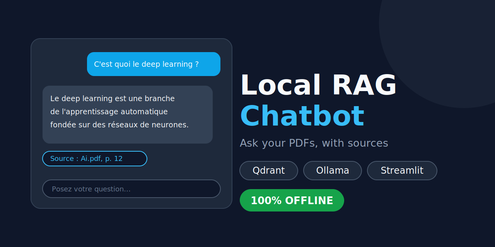
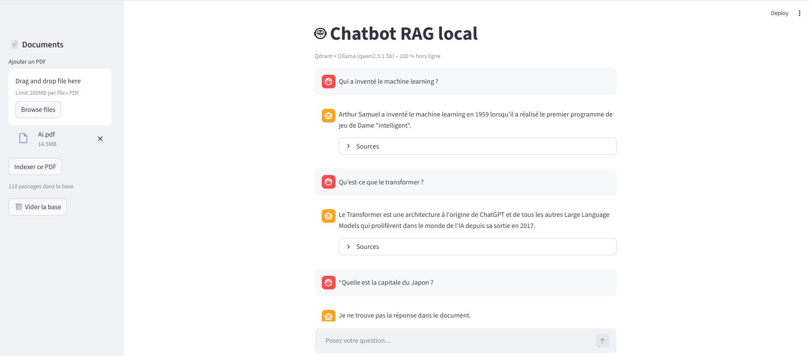

# 🤖 Local RAG Chatbot

Ask questions about a PDF and get answers **with page-level sources**, running **100% offline**: no API key, and no data leaves your machine.

Built with **Qdrant** (vector database), **Ollama** (local LLM), **Sentence-Transformers** (multilingual embeddings) and **Streamlit** (chat interface).



## Demo

| Answer with sources | Question outside the document |
|---|---|
|  | 

## Features

- 📄 **PDF upload** from the interface; several documents can be indexed
- 🌍 **Multilingual retrieval** (French and English) with `intfloat/multilingual-e5-small`
- 📌 **Sources with every answer**: file name, page range and similarity score
- 🛑 **"Not found" handling**: if no passage is similar enough, the bot says so instead of inventing an answer
- ⚡ **Streaming answers** in a chat interface with history
- 🧪 **Evaluation script** that measures how often the right part of the document is retrieved
- 🧹 **Cleaner indexing**: table-of-contents pages are skipped, passages can span page breaks, and re-indexing a file replaces its old passages

## How it works

```
PDF ─► text per page ─► chunks (with page range) ─► embeddings ─► Qdrant
                                                                    │
Question ─► embedding ─► top-k similar chunks (score ≥ threshold) ◄─┘
                                  │
                                  ▼
              Ollama LLM (answers only from the retrieved context)
                                  │
                                  ▼
                    Streamlit chat + sources panel
```

## Installation

**Requirements:** Python 3.10+ and [Ollama](https://ollama.com/). Docker is optional.

```bash
git clone https://github.com/<your-username>/local-rag-chatbot.git
cd local-rag-chatbot

python -m venv venv
# Windows: venv\Scripts\activate
# Mac/Linux: source venv/bin/activate
pip install -r requirements.txt

ollama pull qwen2.5:1.5b
```

By default, Qdrant runs **in local mode** and stores its data in the `qdrant_data/` folder, so no server is needed. To use a Qdrant server instead, run `docker compose up -d` and set `QDRANT_URL = "http://localhost:6333"` in `config.py`.

## Usage

Put your own PDF in a `data/` folder (documents are not included in this repository), then:

```bash
python ingest.py data/your_file.pdf      # index the document
python -m streamlit run ui.py            # open the chat interface
```

You can also upload and index PDFs directly from the interface sidebar.

Command-line version:

```bash
python rag.py "Your question here"
```

> **Local mode note:** only one program can use `qdrant_data/` at a time. Stop the Streamlit app before running `ingest.py` or `evaluate.py`.

## Evaluation

`evaluate.py` runs the questions in `questions.json` through the retriever and checks whether a retrieved passage falls in the expected pages of the document.

Results on a 90-page machine learning course (15 questions, in French):

| Metric | Result |
|---|---|
| Right chapter in the top-4 passages | **15/15** |
| Right chapter as the first passage | **14/15** |

These page ranges are at **chapter level**: the score shows that the retriever finds the right part of the document, not necessarily the exact page. To evaluate your own document, edit `questions.json` (format: `{"question": ..., "source": ..., "expected_pages": [[start, end]]}`) and run:

```bash
python evaluate.py
```

## Configuration

All settings are in `config.py`:

| Setting | Default | Description |
|---|---|---|
| `EMBED_MODEL` | `intfloat/multilingual-e5-small` | Multilingual embedding model |
| `LLM_MODEL` | `qwen2.5:1.5b` | Ollama model used to write answers |
| `CHUNK_SIZE` / `CHUNK_OVERLAP` | `150` / `40` | Passage size and overlap, in words |
| `TOP_K` | `4` | Number of passages sent to the LLM |
| `MIN_SCORE` | `0.79` | Minimum similarity needed to answer; below it, the bot says "not found" |
| `QDRANT_URL` / `QDRANT_PATH` | `None` / `qdrant_data` | Qdrant server URL, or `None` to use local mode in `QDRANT_PATH` |

Tune `MIN_SCORE` with your own documents: print the scores of in-document and out-of-document questions and pick a value between them.

## Project structure

```
├── ui.py                  # Streamlit chat interface
├── rag.py                 # Retrieval + answer generation
├── ingest.py              # PDF → chunks → embeddings → Qdrant
├── core.py                # Shared embedder and Qdrant client
├── config.py              # Settings
├── evaluate.py            # Retrieval evaluation
├── questions.json         # Evaluation questions
├── docker-compose.yml     # Optional Qdrant server
├── requirements.txt
├── scripts/               # Debugging helpers
└── docs/                  # Screenshots
```

## Limitations

- **Small local models can paraphrase loosely.** In testing, a 1.5B model sometimes added details that were not in the document. This is why every answer shows its sources, so it can be checked. Larger models (for example `llama3.2:3b`) are more faithful if your machine has the memory.
- **The bot only knows the document.** If the PDF never defines a concept, the answer will be weak or refused.
- **Scanned PDFs are not supported** (no OCR). Text extraction needs a PDF with real text.
- **Local Qdrant mode allows one process at a time.**

## What I learned

- Retrieval quality matters more than the model. Most bad answers came from bad passages, not from the LLM.
- The table of contents polluted the search results; removing it improved the top results immediately.
- Page-by-page chunking created tiny passages and cut key sentences at boundaries, so chunks now span pages and record a page range.
- With this embedding model, even unrelated questions score around 0.75, so the "not found" threshold has to be calibrated from real scores.
- Telling a small model "say you don't know when unsure" made it over-refuse. The relevance threshold is a better place to handle this.

## Tech stack

Python · Qdrant · Ollama · Sentence-Transformers · Streamlit